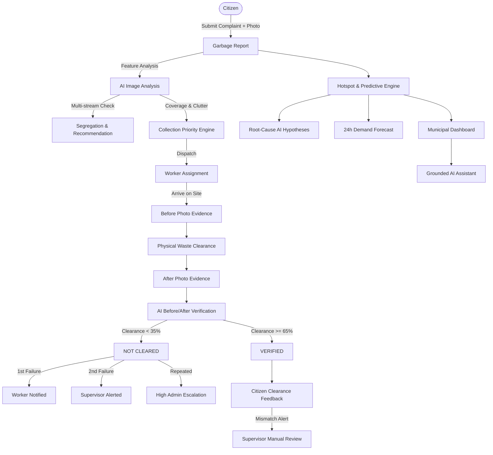

# SwachhAI: AI-Powered Waste Segregation, Collection Verification & Hotspot Intelligence

[](#)
[](#)
[](#)
[](#)
[](#)

A complete, working, AI-first civic-tech product built for India's real-world municipal solid waste management challenges.

---

## 1. Problem Statement

Indian urban local bodies (ULBs) face systemic challenges in solid waste collection and segregation:
- **Unsegregated Dumps**: Mixed biodegradable wet waste and recyclable dry waste contaminate recycling streams and produce toxic leachate in landfills.
- **Unverified Clearances & Ghost Collections**: Sanitation contractors frequently claim clearance without thorough site clearing, leading to chronic public dissatisfaction.
- **Reactive Firefighting**: Municipalities clean spots only after repeated citizen outrage rather than anticipating recurring hotspot patterns.
- **Opacity & Fraud Risk**: Lack of auditable before-and-after photographic evidence and geofenced verification.

---

## 2. Solution Overview

**SwachhAI** provides a closed-loop, automated, AI-verified municipal workflow:
1. **Citizen Reporting**: Citizens report garbage with photos, GPS coordinates, and language preference (English, Tamil, Hindi).
2. **AI Waste Detection & Segregation**: A real computer-vision pipeline analyzes waste categories (Organic/Wet Waste, Plastic, Paper, Metal, Glass, E-Waste, Sanitary Waste, Mixed Waste), flags improper segregation, and issues civic source-segregation recommendations.
3. **Transparent Priority Scoring**: A multi-factor engine scores complaints (0–100) based on severity, age, repeat complaint frequency, and location vulnerability.
4. **Before/After AI Collection Verification**: Workers upload Before and After photos. The CV engine calculates relative waste reduction percentage and validates site cleanliness.
5. **Anti-Fraud Evidence Validation**: Perceptual hash comparison, duplicate photo detection, and GPS proximity checks prevent fraudulent claims.
6. **Automatic Multi-Tier Escalation**: Repeated failures automatically escalate from Worker Notification &rarr; Supervisor Alert &rarr; High Admin Intervention.
7. **Recurring Hotspot Intelligence & Predictive Risk**: Spatial clustering identifies chronic black-spots, generates causal AI Hypotheses (e.g. morning vegetable market unloading), and forecasts next 24-hour overflow risk.
8. **Intelligent Collection Route Optimization**: A TSP route solver with priority constraints minimizes travel distance while clearing high-risk hazards first.
9. **Grounded AI Civic Assistant**: Municipal administrators can query live operations data in natural language with strict grounding and zero hallucination.

---

## 3. Technology Stack

- **Frontend**: React 18, Vite 5, Tailwind CSS, Lucide Icons, Recharts, Leaflet, React-Leaflet
- **Backend**: Python 3.12, FastAPI, Uvicorn, SQLAlchemy, Pydantic, Python-Jose (JWT), Passlib
- **Database**: SQLite (local development) / PostgreSQL-ready architecture
- **AI & Computer Vision**: OpenCV Headless, NumPy, PIL, Scikit-learn
- **Deployment**: Docker & Docker Compose ready

---

## 4. System Architecture



---

## 5. Quick Start (Running Locally)

### Prerequisites

Make sure the following are installed:

- Python 3.12+
- Node.js 18+
- npm
- Git

### Step 1: Clone the Repository

```bash
git clone https://github.com/Gokulakrishnan200005/SwachhAI.git
cd SwachhAI
```

### Step 2: Install Root Dependencies

```bash
npm install
```

### Step 3: Install Frontend Dependencies

```bash
cd frontend
npm install
cd ..
```

### Step 4: Setup Backend

Create and configure the Python virtual environment:

```bash
cd backend
python3 -m venv venv
source venv/bin/activate
pip install -r requirements.txt
cd ..
```

### Step 5: Run Frontend + Backend with One Command

From the project root:

```bash
npm run dev
```

This command automatically starts both the frontend and backend using `concurrently`.

### Application URLs

**Frontend:**

```text
http://localhost:5173/
```

**Backend API:**

```text
http://localhost:8000/
```

**Interactive API Documentation:**

```text
http://localhost:8000/docs
```

### Stop the Application

Press:

```text
Ctrl + C
```

This stops both the frontend and backend processes.

---

## 6. Running Tests

Execute the automated test suite covering authentication, AI detection, segregation, priority scoring, before/after verification, evidence validation, hotspot clustering, and route planning:

```bash
cd backend
PYTHONPATH=. ./venv/bin/pytest tests -v
```

All 13 tests execute and pass out-of-the-box.

## 7. Demo Mode & Demo Credentials

Click the **"Load Demo Data"** button in the top navigation bar to initialize 32 realistic complaints, 10 locations, 10 collection tasks, 5 recurring hotspots, and pre-computed predictive forecasts.

### Role Accounts for Testing
| Role | Email | Password | Responsibilities |
|---|---|---|---|
| **Municipal Admin** | `admin@swachhai.org` | `admin123` | City-wide dashboard, hotspots, audit logs |
| **Zonal Supervisor**| `supervisor@swachhai.org`| `super123` | Task assignment, failure review, manual override |
| **Sanitation Worker**| `worker@swachhai.org` | `worker123` | Task execution, Before/After verification |
| **Citizen** | `citizen@swachhai.org`| `citizen123` | Multilingual reporting, clearance feedback |

Use the **Role Switcher** in the top navigation bar to toggle between personas instantly without manually re-logging in.

---

## 8. Guided 3-Minute Demo Walkthrough

Use the top **Live Demo Flow** banner to experience the full scenario:
1. **File Complaint (Citizen)**: Select a sample photo (e.g. *Mixed Pile*) & landmark &rarr; Submit &rarr; View instant AI waste breakdown, segregation status (*IMPROPER*), and calculated priority score.
2. **Review Priority (System)**: Inspect the transparent scoring rationale (*High visual severity, repeat complaints, market proximity*).
3. **Dispatch Worker (Worker)**: Switch to Worker &rarr; Select Task &rarr; Mark Arrived &rarr; Upload Before photo &rarr; Click *✓ Clean Site (Pass)* or *✗ Dirty Site (Fail)* &rarr; Click *Submit for AI Verification*.
4. **Inspect AI Verification (Worker/Supervisor)**: View relative clearance percentage, before/after scores, and anti-fraud validation status.
5. **Simulate Escalation**: Test the *✗ Dirty Site* button &rarr; triggers automated multi-tier escalation timeline.
6. **Simulate Citizen Feedback Mismatch**: As Citizen, answer "No" to a verified report &rarr; triggers a *Feedback Mismatch Alert* and dispatches supervisor inspection.
7. **Inspect Hotspot Intelligence**: Open Hotspot page &rarr; view recurring clusters, root-cause *AI Hypotheses*, and 24-hour predictive risk forecasts.
8. **Route Planner**: View optimized collection truck path from Central Depot to Landfill.
9. **Query AI Assistant**: Open the assistant & click: *"Which area has the most repeated complaints?"* &rarr; receives exact grounded database figures.

---

## 9. Docker Deployment

Deploy with Docker Compose:
```bash
docker-compose up --build
```
This builds both frontend and backend and exposes the service on port 8000.
